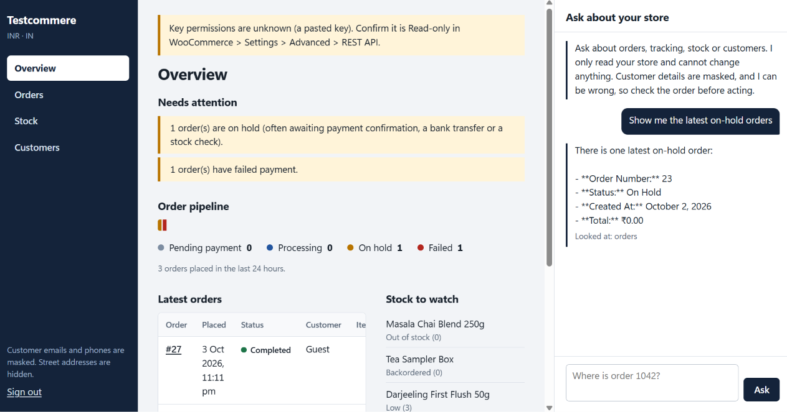
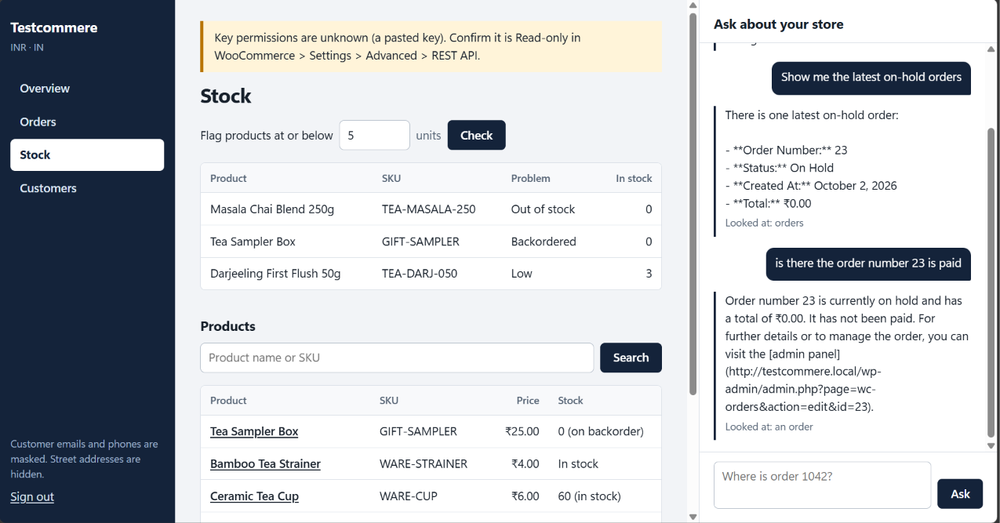

# woo-connector

A **read-only WooCommerce connector for AI agents**, built as an [MCP](https://modelcontextprotocol.io) server in Python.
It lets an agent look up **orders, tracking, products/inventory and customers** from a merchant's WooCommerce store (REST `wc/v3`),
with output shaped for a model, personal data masked by default, and politeness towards the merchant's server built in.

The connector contains **no LLM**. An optional reference agent (`woo-connector chat`) uses OpenRouter so you can try the tools with any tool-calling model.
What the agent can and cannot do: [CAPABILITIES.md](CAPABILITIES.md). Threat model: [SECURITY.md](SECURITY.md). Tool contract: [mcp-tool-spec.json](mcp-tool-spec.json).

## Screenshots

Captured from a real run against a local WooCommerce store (read-only key, customer details masked).





> These were taken before two small fixes: the assistant's `**bold**` and `[link](url)` text is now rendered instead of shown raw, and the Overview columns now stack at medium widths. Refresh them if you want them to match the current build.

## Architecture

```
 AI agent / MCP client ──stdio──┐
                                ├─►  app.py (MCP server, 14 read-only tools, instructions)
 AI agent ─HTTP /mcp + Bearer ──┘          │
                                     tools/  (validate input, map filters, translate errors)
                                           │
                         records/  shaping + schemas (mask PII, sanitise text, compact rows)
                                           │
                         woocommerce/  client (throttle, retry, no redirects) ─► your store /wp-json/wc/v3
                                           │
                         auth/  consent flow, credentials file, bearer guard
```
Layers only import downward.

## Quick start (5 minutes, your own store)

Requires Python 3.12+ and [uv](https://docs.astral.sh/uv/).

1. **Create a read-only key** in wp-admin: *WooCommerce → Settings → Advanced → REST API → Add key*, user = an Administrator or Shop manager, **Permissions = Read**.
2. **Connect** (the secret is hidden while typing, and the key is checked against the store before it is saved):
   ```bash
   uv sync
   uv run woo-connector --store https://your-shop.example auth --manual
   uv run woo-connector status        # "OK: ... Orders visible to this key: N"
   ```
   Or use the browser consent flow, which asks WooCommerce to create the key itself with `scope=read`:
   `uv run woo-connector --store https://your-shop.example auth`. WooCommerce sends the key *server to server* to a local HTTPS
   callback, so this works directly only if the store can reach your machine (a local/Docker store). For a hosted store,
   expose the callback through an HTTPS tunnel that forwards to a local port, e.g.
   `auth --callback-port 8789 --callback-url https://<your-tunnel>.example/callback` (the tunnel should forward to plain `http://localhost:8789`).
3. **Run it**
   - stdio (Claude Desktop etc.): `uv run woo-connector serve`
   - HTTP: `WOO_MCP_TOKEN=<long random> uv run woo-connector serve --http` → `http://127.0.0.1:8000/mcp`, health at `/healthz`.
   - Example MCP client config (stdio):
     ```json
     {"mcpServers": {"woocommerce": {"command": "uv", "args": ["run", "--project", "/path/to/woo-connector", "woo-connector", "serve"],
       "env": {"WOO_STORE_URL": "https://your-shop.example"}}}}
     ```
4. **Try it with a model** (optional): `OPENROUTER_API_KEY=... uv run woo-connector chat -q "What needs attention in my store?"` prints the answer and the tools it used.
5. **Check the contract**: `uv run woo-connector spec --summary` → `14 tools, all read-only: ...`.

## Dashboard + AI chat (`woo-connector web`)

A browser UI for one store: an **Overview** (what needs attention, an order-pipeline bar, latest orders, stock to watch), **Orders**
(search, filter by status, full detail with notes and tracking), **Stock** (low / out of stock / oversold / backordered, product search with
per-variation stock), **Customers**, and an **assistant panel** docked on the right that answers questions with the same read-only tools.

```bash
export WOO_WEB_PASSWORD='a-long-passphrase'     # PowerShell: $env:WOO_WEB_PASSWORD = "..."
export OPENROUTER_API_KEY=sk-or-...             # optional: without it the dashboard works and chat is switched off
uv run woo-connector web                        # http://127.0.0.1:8080
```

- **Read-only.** The UI can only call the 14 read tools; there is no button that changes the store. Changes go through the "Open in WooCommerce" link.
- **Access.** Password sign-in (constant-time compare, lockout after 5 failures per 5 minutes), HttpOnly + SameSite=Strict signed session cookie that expires after 12 hours and is revoked on sign-out, and a required custom header on every POST (CSRF).
- **Hardening.** Strict Content-Security-Policy (no inline script, no external hosts), `nosniff`, no framing, no-store on data. All store text is inserted as text, never HTML.
- **Privacy.** Emails/phones are masked and street lines hidden, exactly as in the MCP tools (`WOO_PII_MODE`). Chat history lives in server memory only, per session.
- **Putting it online.** It speaks plain HTTP. Bind to `127.0.0.1` and put HTTPS in front, e.g. Caddy: `caddy reverse-proxy --from https://desk.example.com --to 127.0.0.1:8080`. The session cookie is marked `Secure` automatically when the request arrives over HTTPS (including `X-Forwarded-Proto: https`).
- **Scope.** One store and one shared password per process. There are no per-user accounts, roles or audit trail, and it is not a multi-tenant service.

Tested by `tests/test_web.py` (access control, CSRF, lockout, cookie tampering/expiry/replay, masking, parameter validation, chat limits) and by
`scripts/ui_smoke.py`, which runs the real `app.js` in jsdom (Node.js) against a live server and the fake store: navigation, search, drawers, hostile
note text, masking, chat and sign-out. The author has used it in a desktop browser against a local store (screenshots above); the narrow-screen layout has not been looked at in a real browser.
Run `cd tests/ui && npm install` once, then `uv run python scripts/ui_smoke.py`.

## Configuration

| Variable | Default | Meaning |
|---|---|---|
| `WOO_STORE_URL`, `WOO_CONSUMER_KEY`, `WOO_CONSUMER_SECRET` | – | Use a key without the saved file; env wins over the file |
| `WOO_KEY_PERMISSIONS` | `unknown` | Never guessed for pasted keys |
| `WOO_PII_MODE` | `masked` | `full` is an explicit opt-in |
| `WOO_MAX_RPS` / `WOO_BURST` | `4` / `8` | Request throttle |
| `WOO_CACHE_TTL` | `0` | Seconds to cache reads (0 = always live) |
| `WOO_VERIFY_TLS` | `true` | `false` for dev stores with self-signed certs only |
| `WOO_MCP_TOKEN` | generated & printed | Bearer token for `serve --http` |
| `WOO_LOG_LEVEL`, `WOO_LOG_FORMAT` | `INFO`, `text` | Logs go to stderr only |
| `OPENROUTER_API_KEY`, `OPENROUTER_MODEL` | – , `openai/gpt-4o-mini` | Chat (CLI and web) |
| `WOO_WEB_PASSWORD`, `WOO_WEB_SECRET` | generated, random | Dashboard sign-in; secret keeps sessions across restarts |

See `.env.example`. Credentials are stored in `~/.config/woo-connector/credentials.json` (`XDG_CONFIG_HOME` honoured; dir `0700`, file `0600`), keyed by store URL. `woo-connector forget` deletes them; **also revoke the key in WooCommerce**.

## How it works

**Authentication.** HTTPS stores use HTTP Basic with the key/secret. Plain-HTTP stores use OAuth 1.0a (HMAC-SHA256, fresh nonce and timestamp per attempt; pinned against an independent `openssl` vector). The key is never put in the query string over HTTPS. Redirects are refused so credentials cannot reach another origin.

**Rate limiting.** WooCommerce core does not rate-limit `wc/v3`; limits come from hosts, CDNs and WAFs. Every call goes through a shared token bucket, a concurrency cap and a 60 s time budget. `429/502/503/504` and network errors are retried with backoff; `Retry-After` (seconds or date) is honoured; on `429/503` **all** callers pause, then resume at a *lower* rate (halved, at most once a second, floor 0.2 req/s, recovering slowly on success), so the client learns the host's real limit instead of stampeding. A wait over 30 s is refused with an agent-readable message.

**Shaping.** Compact typed records, one money format (the store's own decimals), UTC ISO timestamps, empty fields dropped, `_links`/`meta_data`/tokens removed. A list row is at least 8x smaller than the raw order (tested). Customer/merchant text is stripped of HTML, truncated to 500 characters, and only appears under `*_text` keys.

## Failure behaviour

| Situation | What the agent is told |
|---|---|
| No credentials | How to run `woo-connector auth` / which env vars to set |
| Key revoked / wrong (401) | The merchant needs to reconnect; the cached client is dropped so new credentials load without a restart |
| Clock skew (timestamp/nonce) | Fix the system clock; reconnecting won't help |
| Permission (403) | Key owner lacks a role, or a firewall blocks it |
| Rate limited | Wait time asked; tell the user and retry later (fails fast beyond 30 s / 60 s) |
| Store down / network | "Could not reach the store ... check the URL" after bounded retries |
| Redirect | Reconnect with the canonical URL |
| WAF challenge / non-JSON | Check the store URL and firewall |
| Endpoint missing (`rest_no_route`) | WooCommerce inactive or permalinks set to "Plain" |
| Unknown order/product/customer | Says so and names the tool to use next |

## Evidence: what was run

Run in a sandbox with Python 3.12, **against an in-repo fake store** (`tests/fake_woo.py`), not a real WooCommerce:

- `uv run pytest` → 184 passed (includes the web UI backend tests) (HTTP mocked with respx; consent flow over real local sockets; the connector over real sockets against the fake).
- `uv run python scripts/demo.py --fake --rate-limit` → 15/15 PASS ([transcript](docs/demo-output-fake-store.txt)).
- `uv run python scripts/fault_check.py --fake` → store down + 40 concurrent calls, key revoked, recovery in one session: all PASS.
- `serve --http` as a separate process: `/healthz` 200, `/mcp` 401 without/with a wrong token, 200 with it; a real MCP client listed 14 tools over HTTP and over stdio.
- `uv run python scripts/ui_smoke.py` → 29/29: the real dashboard JavaScript in jsdom against a live server (see the Dashboard section for what that does not cover).
- `scripts/mutation_check.py` plants deliberate bugs in a copy of the repo and requires the suite to fail for each (results below).

**Not run (no Docker or API keys available):** `docker/` store and `scripts/setup_store.sh`/`seed.php`, `demo.py --https`, `fault_check.py` against Docker, `woo-connector chat` against OpenRouter, `docker build`, `uv build`/wheel install. Treat those files as untested until you run them. The fake store was written by the same author as the connector, so passing it is not proof of compatibility with real WooCommerce; **your own store is the real test** (`demo.py` and `status` work against it).

### Mutation results
26 deliberate bugs (unmasked email/phone/street, customer role filter off, callback state unchecked, 429 not retried, `Retry-After` ignored,
no time budget, redirects followed, reused OAuth nonce, OAuth secret without trailing `&`, world-readable credentials file, untruncated text,
unstripped HTML, websocket allowed, any bearer token accepted, stale client after auth failure, double-counted parent stock, ...).
First run: **25/26 caught**. The survivor (parent-managed stock double-counted per variation) exposed a real test gap: the fixture's variations were in stock.
After adding a sold-out parent case it is caught (re-run of that mutation: 1/1). The full 26 were not re-run end to end after that fix.

## Assumptions and limitations
- Read-only by design. WooCommerce keys never expire (revoke manually).
- Search is substring-only; phone numbers match only as stored. `search_products` uses WooCommerce's `search` plus an exact `sku` lookup (assumed to include variations; verify on your version).
- `list_low_stock` scans the catalogue (default cap 500 products); `truncated` says so.
- Guest checkouts have no customer record: reachable via `search_orders` only.
- No webhooks; one store per process.
- Some hosts strip the `Authorization` header (Apache CGI/FastCGI), breaking Basic auth: a server config fix, not a query-string key.
- Order number equals order ID unless a numbering plugin is installed. Pretty permalinks are required.
- Mixed-currency or custom order-numbering plugins were not tested.

## Before going live with a merchant
Which role owns the key? Is it Read-only? Is the host behind a WAF/CDN that challenges API clients? What are the host's real rate limits? Is a Shipment Tracking plugin or custom field used for tracking? Is `WOO_PII_MODE=masked` acceptable to their LLM provider terms? Who revokes the key when the project ends?

## Measuring impact
Compare before/after on: time to answer "where is my order?", share of order lookups resolved without a human, tickets deflected, wrong-answer rate on a sampled set (any invented tracking is a failure), and API calls per answer (`Stats` counters).

## Production path
Hosted callback + KMS-backed secret vault; multi-tenant with per-merchant Redis token buckets; webhooks + cache instead of polling; gated writes (confirmation, idempotency, audit log); metrics, traces and alerting.

## Development
`make install check` · `make demo` · `uv run woo-connector spec` (commit `mcp-tool-spec.json`; CI fails if stale) · Dev store: `scripts/setup_store.sh` (untested, see above).

## Author and license

Created and maintained by **abinesh0309@gmail.com**. Released under the [MIT License](LICENSE).
